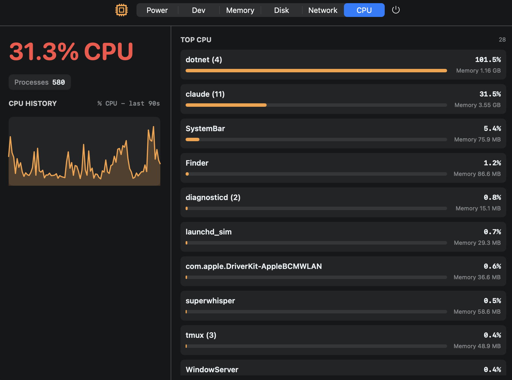

# SystemBar

A single menu bar icon for Memory, CPU, Disk, Network and whatever else you plug in — instead of a row of separate ones.



SystemBar replaces a cluttered row of individual menu bar monitors with one icon and a tabbed popover. Tap between tabs to see memory pressure, per-process CPU share, where disk space goes and network throughput, all sampled live from macOS kernel APIs.

Every tab is a plugin. The app ships none of its own: the Memory, Disk, Network and CPU tabs (and Power and Dev, kept but not installed by default) live in [system-monitor-core-plugins](https://github.com/ih8celery/system-monitor-core-plugins), whose `scripts/install.sh install` builds them against the installed app and adds them to `plugins.json`.

## Choosing tabs

Which tabs appear, and in what order, comes from a file the app writes, empty, the first time it runs:

```
~/Library/Application Support/SystemBar/plugins.json
```

A plugin's installer adds its entries. Reorder the entries to reorder the tabs, set `"enabled": false` on one to hide it, and press Relaunch in the popover header to apply the change. The first tab listed is the one that opens; with nothing listed the popover says so and names the file.

```json
{ "plugins": [
  { "path": "~/Library/Application Support/SystemBar/PlugIns/Memory.bundle" },
  { "path": "~/Library/Application Support/SystemBar/PlugIns/CPU.bundle" },
  { "path": "~/Library/Application Support/SystemBar/PlugIns/Network.bundle", "enabled": false }
] }
```

A `"path"` entry points at a bundle anywhere on disk (absolute, or starting with `~/`). A `"name"` entry names a bundle inside the app's `Contents/PlugIns`, which the app as built leaves empty.

An entry may carry a `"settings"` object for its plugin. The app checks only that it is an object; the keys are the plugin's own, and a plugin reports a value it cannot use in its own panel rather than refusing to load. The Disk tab reads one key: `"backgroundScans": false` stops its folder scans from running while the tab is hidden; they still run while it shows, and on its rescan button.

```json
{ "plugins": [
  { "path": "~/Library/Application Support/SystemBar/PlugIns/Disk.bundle", "settings": { "backgroundScans": false } }
] }
```

A tab may tap you on the shoulder with a notification when one of its rules fires, such as low disk space; each tab's rules and their thresholds live in its `settings`. The app shows each rule at most once an hour and each tab at most five notifications an hour, and macOS asks whether SystemBar may send notifications the first time any rule fires, not at launch. `"notifications": false` at the top level of the file, beside `"plugins"`, turns them all off.

An entry the app cannot load, say a misspelt name, still gets a tab: it is titled Error and shows the entry, what went wrong, and where the file is, so a typo is never silent. A file that cannot be read or parsed at all gives one Error tab and nothing else. A key the app does not know, or a value of the wrong type, is reported with its place in the file. Two things the parser cannot catch: a trailing comma is accepted, and if a key appears twice the first one wins.

`./SystemBar.app/Contents/MacOS/SystemBar --list-plugins` prints the same outcome to the terminal, one line per enabled entry, and exits without opening a window (on a fresh machine it creates the file, just like a normal launch). It always exits 0, even when a line reports an error, so a script has to look at the text of each line rather than the exit code; a line for a failed entry starts with `error`, and the location it shows for a `name` entry is the name as written in `plugins.json` (say `Clock.bundle`), not a resolved path. A plugin that samples while hidden has `background every <n>s` at the end of its line. `SYSTEMBAR_PLUGINS_FILE=/some/other.json` points one run at a different file.

Relaunch restarts the app in place: when SystemBar was installed as a login item it asks launchd to restart it, and otherwise it starts a fresh copy and quits. If a relaunch fails, the reason goes to the system log.

Lock, beside it, locks the Mac's screen, the same as Control-Command-Q. The popover has no Quit: the login service would start SystemBar again at once, so `./install.sh uninstall` is how to stop it.

## Writing a plugin

A tab is a `.bundle` built in Swift against the SDK inside the app. `Examples/HelloTab/` is the smallest one that loads: an `Info.plist` naming the class, and one Swift file with a class that adopts `TabPlugin`, collects on a schedule the app runs for it, and returns a SwiftUI view.

```bash
./build-plugin.sh Examples/HelloTab "$HOME/Library/Application Support/SystemBar/PlugIns/HelloTab.bundle" ~/Applications/SystemBar.app
```

Then add `{ "path": "~/Library/Application Support/SystemBar/PlugIns/HelloTab.bundle" }` to `plugins.json` and press Relaunch. The plugin can run subprocesses through the host (an executable path and arguments, never a shell), read the shared process summary (`host.processes.value` now, or `host.processes.publisher` to follow it, as the core Power tab does), and use the app's palette and components. Give your plugin its own executable name in Info.plist (it doubles as the Swift module name, so make it a valid identifier) and its own `@objc(...)` class name; the app refuses a bundle whose class name another loaded bundle already defines.

The core tabs in [system-monitor-core-plugins](https://github.com/ih8celery/system-monitor-core-plugins) are built this way: `Plugins/Power/` there is the smallest, and `Plugins/Network/` shows following the 1-second feed and running slow work on a queue of its own. The app carries this `build-plugin.sh` at `Contents/Resources/build-plugin.sh`, so a plugin project needs only an installed app, not this repository.

A plugin says in `sharedFeeds` which of the host's two shared readings it uses, and the host samples only what the showing tab asks for:

| Feed | What it holds | When the host samples it |
|---|---|---|
| `.fastStats` | CPU percent (the whole machine, each core, and the user/system split) and network rates over the physical (`en`) interfaces only, so a VPN download counts once, with 90 seconds of history for the headline figures | Every second while the window is open, whatever the tab, so the history has no gaps |
| `.processes` | The top processes by CPU and by memory | Every 10 seconds, only while a tab that declares it is showing |

Nothing is sampled while the window is closed, unless a plugin declares a `backgroundInterval`: then the app keeps calling that plugin's `collect()` at that cadence while its tab is hidden, on the plugin's own queue, with a floor of 5 seconds. The first such call after the Mac wakes waits two minutes, so nothing lands on the login moment. The shared feeds run for the open window and its showing tab, never for a hidden one, so a background `collect()` samples for itself. The table below says which tabs sample while hidden; `--list-plugins` reports it too, as `background every <n>s` on that plugin's line.

To test a plugin that follows a feed, make the feed with `Feed.forTesting(initial:)`. It returns a new feed and a closure that writes to that feed alone, the way the host writes its own; a plugin cannot write the host's feeds, so this is the only writer it gets. Hand the feed to a `HostServices` you build yourself, push a reading, and let the main run loop turn once, because a feed delivers on the main thread:

```swift
@MainActor func testFollowsTheProcessFeed() {
    let (processes, sendProcesses) = Feed.forTesting(initial: ProcessSummary())
    let host = HostServices(
        homeDirectory: "/Users/test",
        processes: processes,
        fastStats: Feed(initial: FastStatsSnapshot()),
        runner: { _, _, _, _ in CommandOutput(output: "", error: "", status: 0, didTimeout: false) },
        log: { print($0) }
    )
    let plugin = MyPlugin(host: host)  // keeps the top CPU group's name in `busiest`

    sendProcesses(ProcessSummary(rows: [
        ProcessSnapshot(name: "clang", count: 4, physical: 2_000_000_000, virtualSize: 0, cpu: 250)
    ]))
    RunLoop.main.run(until: Date().addingTimeInterval(0.1))

    assert(plugin.busiest == "clang")
}
```

A plugin's `refreshInterval` is clamped to between 0.25 seconds and one day: NaN, zero, and negative values become 0.25 seconds, and infinity or anything larger becomes one day, with each substitution logged. Build your plugin with the same Xcode as the app, or a newer one — the SDK interface names types from that Xcode's SwiftUI, so an older Xcode cannot read it.

A plugin gets two more things from `HostServices`. `settings` is its entry's `"settings"` object from `plugins.json`, as a `PluginSettings` with typed accessors (`bool(forKey:)`, `number(forKey:)`, `string(forKey:)`); a present key of the wrong type reads as nil from those and non-nil from the subscript, so the plugin can tell the person. The app never checks a key inside `settings`, only that `settings` is an object; `"settings": null` counts as leaving it out, while `"enabled": null` is rejected like any other wrong type. `dataDirectory` is a folder of its own, `~/Library/Application Support/SystemBar/PluginData/<identifier>/`, which may not exist until the plugin creates it; anything a plugin saves between launches goes there and nowhere else. `SYSTEMBAR_PLUGIN_DATA_ROOT=/some/folder` moves the root for every plugin, which is how tests and scripts keep the real folder untouched.

`host.notify(id:title:body:)` asks the app for a notification. `id` names the rule and is your plugin's own: the app keys it by your plugin's identifier, shows one notification per rule per hour, and drops repeats inside that hour, so a rule may call `notify` on every sample while it holds. Keep the id the same while the rule holds: a reading belongs in the body, and a plugin shows at most five notifications an hour across all its ids, after which the app drops the rest and says so once in the log. Nothing is shown when the person has set `"notifications": false` or refused permission, or when both the title and the body are empty, and the call never says whether it was shown. `SystemBar --preview` prints each notification your plugin posts to standard error, as `notification <identifier>/<id>: <title> - <body>`, with no hourly limit. In tests, `HostServices.recordingNotifications()` gives a `notify` to pass to the `HostServices` initializer that takes one, and a `posted()` that returns every notification the plugin asked for, in order, without reaching Notification Center.

A plugin that needs to keep sampling while its tab is hidden declares `backgroundInterval` (nil by default). The app then calls its `collect()` at that cadence, clamped to between 5 seconds and one day, while the window is closed or another tab is showing, and restarts the cadence with a call two minutes after every wake of the Mac or its screen, so no call lands on the login moment. That restart means a long interval still gets a call soon after each wake: keep one call cheap, and keep any slower cadence (a scan every few hours, say) in your own bookkeeping, checked on each call, as the Disk tab does. It is the same `collect()`; a plugin that wants to do less while hidden keeps a flag from `visibilityChanged(isVisible:)`. Shared feeds do not run for a hidden tab, so a background `collect()` samples for itself. Say in your plugin's README what it runs while hidden and how often; the app reports the cadence in `--list-plugins`.

The SDK's documentation is the doc comments in `Sources/Kit/`. The app ships them beside the interface, as `Contents/Resources/SDK/SystemBarKit.swiftdoc`, so tools that read a module's documentation through the compiler, such as `swift-symbolgraph-extract` (and so DocC), show them for a plugin built against the app. The `.swiftinterface` file itself holds only signatures; the comments themselves are in the repository under `Sources/Kit/`.

The host times how long your plugin's `init(host:)` takes and logs a warning once it passes 100 ms, so put slow work in `collect()` instead of `init(host:)`.

A bundle runs inside the app with its privileges. Nothing checks or sandboxes it, so load only bundles you built or trust.

See `docs/one-page/systembar-tab-plugins.md` for the full contract.

### Previewing a plugin without installing it

`SystemBar --preview` shows one plugin outside the menu bar, through the same loader, without
reading or writing `plugins.json`:

```
SystemBar.app/Contents/MacOS/SystemBar --preview MyTab.bundle --png my-tab.png
SystemBar.app/Contents/MacOS/SystemBar --preview MyTab.bundle --window
```

`--png` tells the plugin it is showing, runs `collect()` once, waits for its update, saves a
picture (900×680 points at 2×, or `--size WxH`) and exits. `--window` opens the tab in a
window and refreshes it on its own timer until you close it. `--settings file.json` hands the
plugin the same object a `"settings"` entry would. `--replies file.json` answers the plugin's
commands from a file instead of running them:

```json
{ "replies": [ { "path": "/bin/date", "arguments": ["+%H:%M:%S"], "output": "12:34:56\n" } ] }
```

A reply matches on the exact path and arguments; `error` and `status` are optional. A command
with no reply exits 127 with `no canned reply for <command>`. The plugin's data folder is a
fresh temporary one. Exit codes: 0 done, 1 the bundle did not load or could not be drawn (the
same line `--list-plugins` prints), 2 a wrong argument or file. Pictures are for looking at,
not for comparing pixel by pixel: fonts change with macOS.

## Requirements

- **macOS 14 (Sonoma) or later** — the SDK's stable interface records that target, and the code already used a macOS 14 API
- **Xcode Command Line Tools**, for `swiftc`:
  ```bash
  xcode-select --install
  ```

There are no third-party dependencies and no package manager. `build.sh` calls `swiftc` directly on the sources.

## Build

```bash
./build.sh
```

`./build.sh` builds the SDK (`libSystemBarKit.dylib` and its `.swiftinterface`) and the app into a `SystemBar.app` bundle in the repo directory; the SDK ships inside the app at `Contents/Frameworks` and `Contents/Resources/SDK`.

The app is **not code-signed or notarized**. Building it yourself is fine — locally compiled binaries aren't quarantined, so Gatekeeper stays out of the way. But copying the built `.app` to another Mac will trip Gatekeeper there, and rebuilding changes the binary's identity, so macOS may re-ask for any permissions you previously granted.

## Install as a login item

```bash
./install.sh
```

This builds the app, copies it to `~/Applications/SystemBar.app`, and registers a LaunchAgent that keeps it running across login.

To check what's currently installed:

```bash
./install.sh status
```

To uninstall:

```bash
./install.sh uninstall
```

## What SystemBar reads from your system

The app on its own reads two things, and only while its window is open: CPU and network counters from the kernel (`host_statistics`, `sysctl`) every second, and `/bin/ps` every 10 seconds while the showing tab asks for the process list. Everything else is run by the tabs you install; the core tabs list theirs in [system-monitor-core-plugins](https://github.com/ih8celery/system-monitor-core-plugins#what-the-tabs-read-from-your-system), and the Disk tab's scans run with the window closed.

SystemBar runs entirely as your user and never asks for `sudo`. The host launches every subprocess with an explicit executable path and argument array, never through a shell. A loaded plugin is not held to that rule and can run whatever it likes with your privileges, which is why you should only install plugins you trust.

## Test

```bash
./test.sh
```

After the in-process tests, `./test.sh` runs the boundary check: it builds `Examples/HelloTab` against the SDK inside the `SystemBar.app` it just built, then runs `--list-plugins` against a temporary config naming that HelloTab bundle by path, a missing path, a missing name, and a duplicate — the one test that crosses a real dylib boundary, loading a bundle built separately from the app through the same loader a user's bundle goes through. It then runs `--list-plugins` once more against a `plugins.json` that does not exist yet, as on a new user's first launch, and expects an empty list and no bundles inside the app. It also checks the app carries `build-plugin.sh` and that the copy inside an app builds against that app. Last, it searches the sources for the names of the types the move to plugins deleted, and fails if any of them is back.

You can also check the plugin loader from a script, without opening the app: `./SystemBar.app/Contents/MacOS/SystemBar --list-plugins` prints what it would show and exits 0 regardless of whether any line reports an error, so the boundary check in `test.sh` compares the printed lines rather than the exit status. Point `SYSTEMBAR_PLUGINS_FILE` at a temporary file first, so the check reads and writes that instead of your real `plugins.json`.

## Status

This is a personal project maintained casually in spare time — no guarantees on response time, but bug reports, feature requests, and pull requests are genuinely welcome.

## License

MIT — see [LICENSE](LICENSE).
